# UI change report — Tab picks in the pickers, sharper fuzzy search, shortcuts ready out of the box

*Nov 11, 2026, 01:06 GMT+1 · ad96bd4cb → ad96bd4cb (+uncommitted) · [interactive viewer](index.html)*

## 1. Original request

> A user mentioned it was important to be able to start timers and toggle them with a keyboard shortcut easily with the desktop/Mac app - is this possible? It must be incredibly easy for the user to work with.
> 
> Also I noticed sometimes I’m typing in a field like project and expect the first result to select when hitting tab but it doesn’t - it should be a super efficient fast powerful fuzzy search where tabbing easily selects and moves to the next field. Please ensure the desktop app is as streamlined and polished as posssible

## 2. Interpretation

Global hotkeys already existed but every one shipped unbound behind Settings › Keyboard shortcuts, so nobody had a shortcut until they found that tab; on a Mac, start/stop, new timer and show/hide now come bound. In the project and task search, Tab left the field with its old value (typing "des", Tab, ⌘↵ started the timer on the previous project); Tab now takes the highlighted match and moves to the next field, exactly as Return does. The matcher was also tightened so loose queries stop listing unrelated projects, and rows mark the characters that matched.

## 3. Changes

1. Search pickers: Tab picks the highlighted row and moves on (project → task search → date); ⇧Tab in the task search reopens the project search
2. Tab with a query that matches nothing stays in the field; Tab through an untouched list changes nothing
3. Matcher: whole word > word start > initials ("wr") > inside a word > abbreviation ("dsgn"); scattered letters no longer match
4. Ties: a match in the project name before one in the client, then most recently tracked first
5. Accent-free typing also covers ø, ł, ß, æ ("sondergaard", "lodz"); word starts work in non-Latin scripts
6. Rows, client headings and preset rows mark the matched characters (tint, no weight change)
7. Presets search: highlight on the best match, ↑↓ walk it, Return starts it
8. Mac: ⌃⌥⌘S start/stop, ⌃⌥⌘N new timer, ⌃⌥⌘Z show/hide bound on first launch; rows already bound are kept, a cleared default stays cleared
9. Shortcuts tab: one line saying these work from any app; tray tooltip names the start/stop hotkey
10. Start/stop pressed where it cannot start anything (locked week, invoiced entry, failed request) shows the popover instead of doing nothing

## 4–5. Before / after

### 1. Typing "des" in the project search

**(1)** Matched letters are marked; best match first

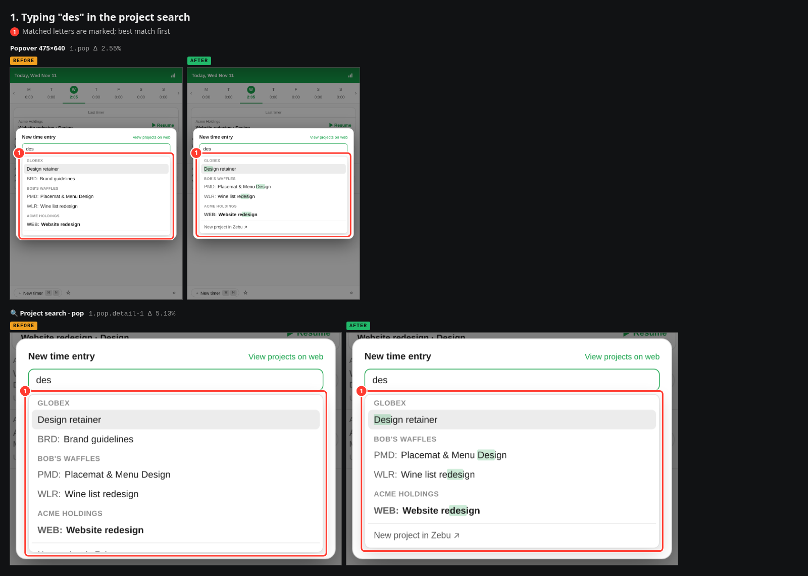

| Ref | View | Before | After | Diff | Δ px |
|---|---|---|---|---|---|
| `1.pop` | Popover 475×640 | [before](captures/before/search-des/popover.png) | [after](captures/after/search-des/popover.png) | [diff](diffs/search-des_popover.png) | 2.55% |
| `1.pop.detail-1` | 🔍 Project search · pop | [before](captures/before/search-des/detail-1@popover.png) | [after](captures/after/search-des/detail-1@popover.png) | [diff](diffs/search-des_detail-1@popover.png) | 5.13% |

### 2. Tab after typing "des"

Before: the list closes and the project stays as it was. After: the top match is taken and the task search opens.

**(1)** Project is the one typed for

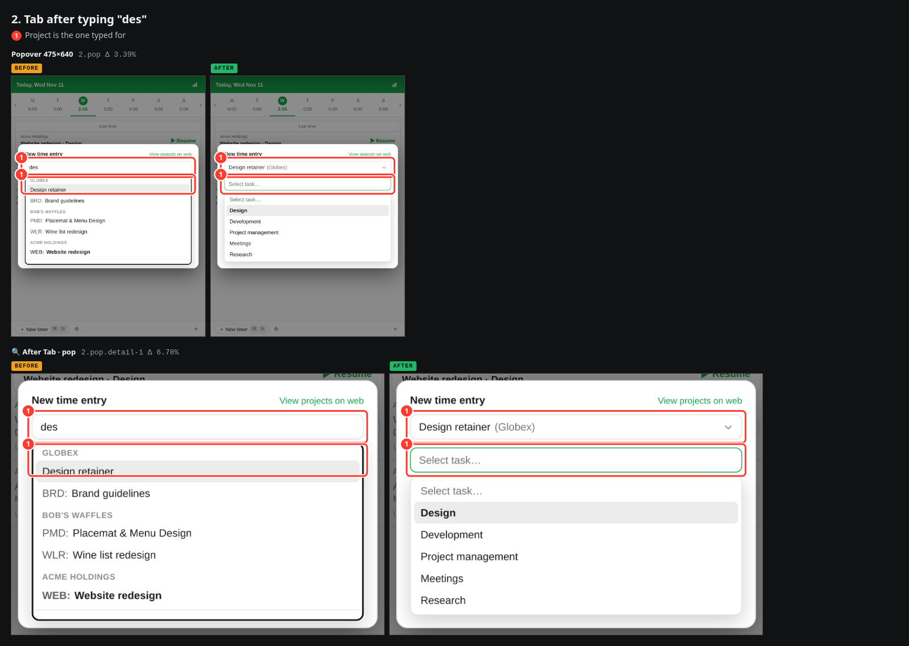

| Ref | View | Before | After | Diff | Δ px |
|---|---|---|---|---|---|
| `2.pop` | Popover 475×640 | [before](captures/before/tab-picks-project/popover.png) | [after](captures/after/tab-picks-project/popover.png) | [diff](diffs/tab-picks-project_popover.png) | 3.39% |
| `2.pop.detail-1` | 🔍 After Tab · pop | [before](captures/before/tab-picks-project/detail-1@popover.png) | [after](captures/after/tab-picks-project/detail-1@popover.png) | [diff](diffs/tab-picks-project_detail-1@popover.png) | 6.78% |

### 3. Then "dev", Tab: task set, date has focus

**(1)** Project and task both set by Tab

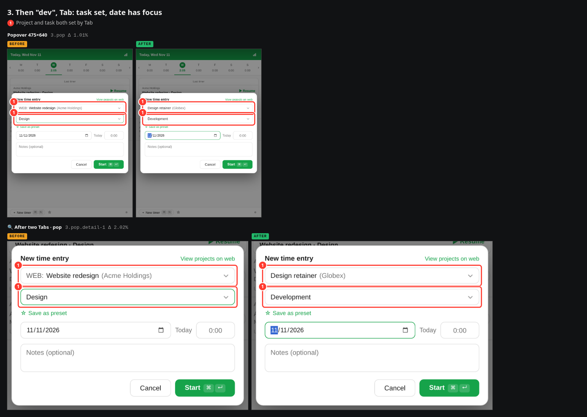

| Ref | View | Before | After | Diff | Δ px |
|---|---|---|---|---|---|
| `3.pop` | Popover 475×640 | [before](captures/before/tab-picks-task/popover.png) | [after](captures/after/tab-picks-task/popover.png) | [diff](diffs/tab-picks-task_popover.png) | 1.01% |
| `3.pop.detail-1` | 🔍 After two Tabs · pop | [before](captures/before/tab-picks-task/detail-1@popover.png) | [after](captures/after/tab-picks-task/detail-1@popover.png) | [diff](diffs/tab-picks-task_detail-1@popover.png) | 2.02% |
| `3.pop.video` | ▶ pop | [before](captures/before/tab-picks-task/video@popover.mp4) | [after](captures/after/tab-picks-task/video@popover.mp4) | — | — |

### 4. Initials: "wr"

**(1)** Initials find the project

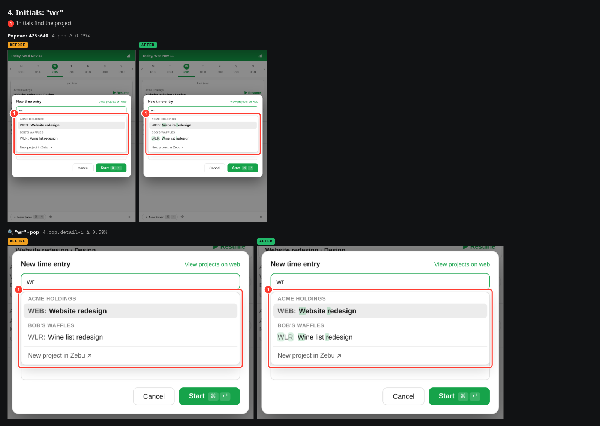

| Ref | View | Before | After | Diff | Δ px |
|---|---|---|---|---|---|
| `4.pop` | Popover 475×640 | [before](captures/before/search-initials/popover.png) | [after](captures/after/search-initials/popover.png) | [diff](diffs/search-initials_popover.png) | 0.29% |
| `4.pop.detail-1` | 🔍 "wr" · pop | [before](captures/before/search-initials/detail-1@popover.png) | [after](captures/after/search-initials/detail-1@popover.png) | [diff](diffs/search-initials_detail-1@popover.png) | 0.59% |

### 5. Loose typing: "dsn"

**(1)** Only real matches listed

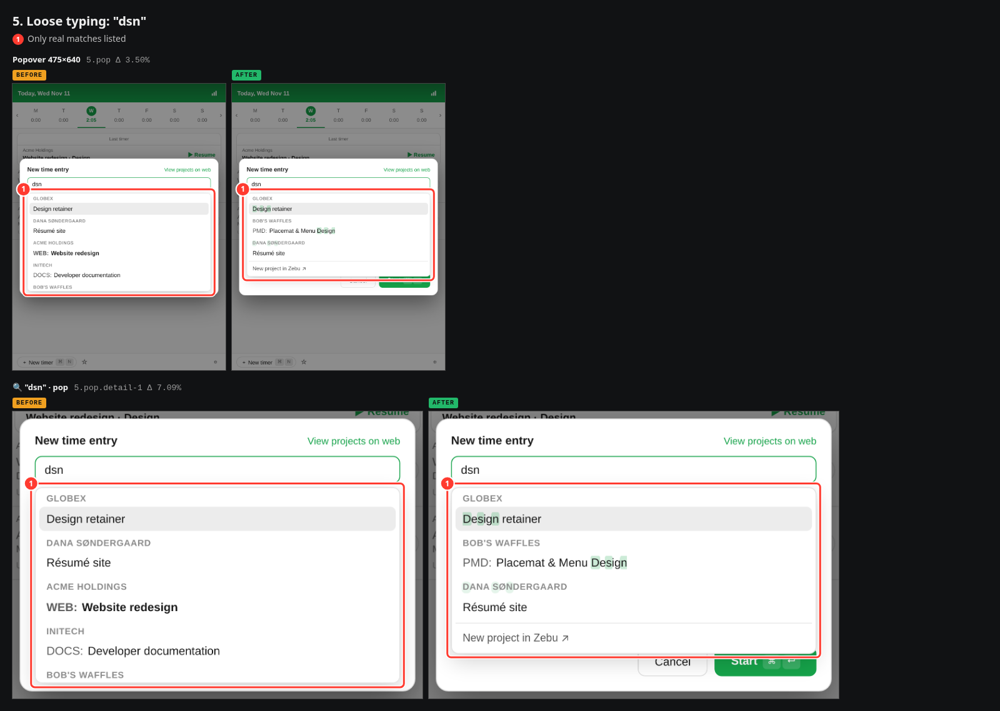

| Ref | View | Before | After | Diff | Δ px |
|---|---|---|---|---|---|
| `5.pop` | Popover 475×640 | [before](captures/before/search-loose/popover.png) | [after](captures/after/search-loose/popover.png) | [diff](diffs/search-loose_popover.png) | 3.50% |
| `5.pop.detail-1` | 🔍 "dsn" · pop | [before](captures/before/search-loose/detail-1@popover.png) | [after](captures/after/search-loose/detail-1@popover.png) | [diff](diffs/search-loose_detail-1@popover.png) | 7.09% |

### 6. Client plus project: "acme mob"

**(1)** Client heading marked too

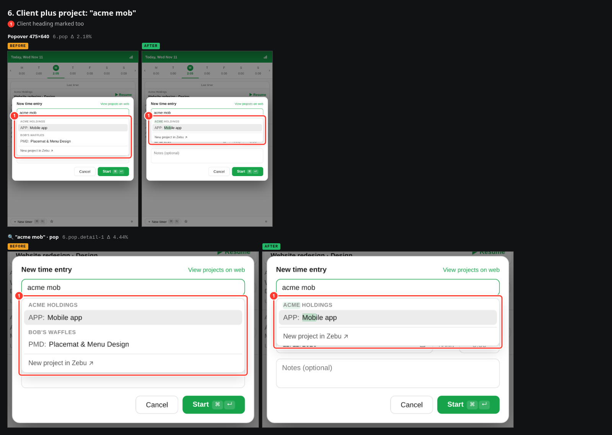

| Ref | View | Before | After | Diff | Δ px |
|---|---|---|---|---|---|
| `6.pop` | Popover 475×640 | [before](captures/before/search-client/popover.png) | [after](captures/after/search-client/popover.png) | [diff](diffs/search-client_popover.png) | 2.18% |
| `6.pop.detail-1` | 🔍 "acme mob" · pop | [before](captures/before/search-client/detail-1@popover.png) | [after](captures/after/search-client/detail-1@popover.png) | [diff](diffs/search-client_detail-1@popover.png) | 4.44% |

### 7. Project search, dark

**(1)** Match marks in dark

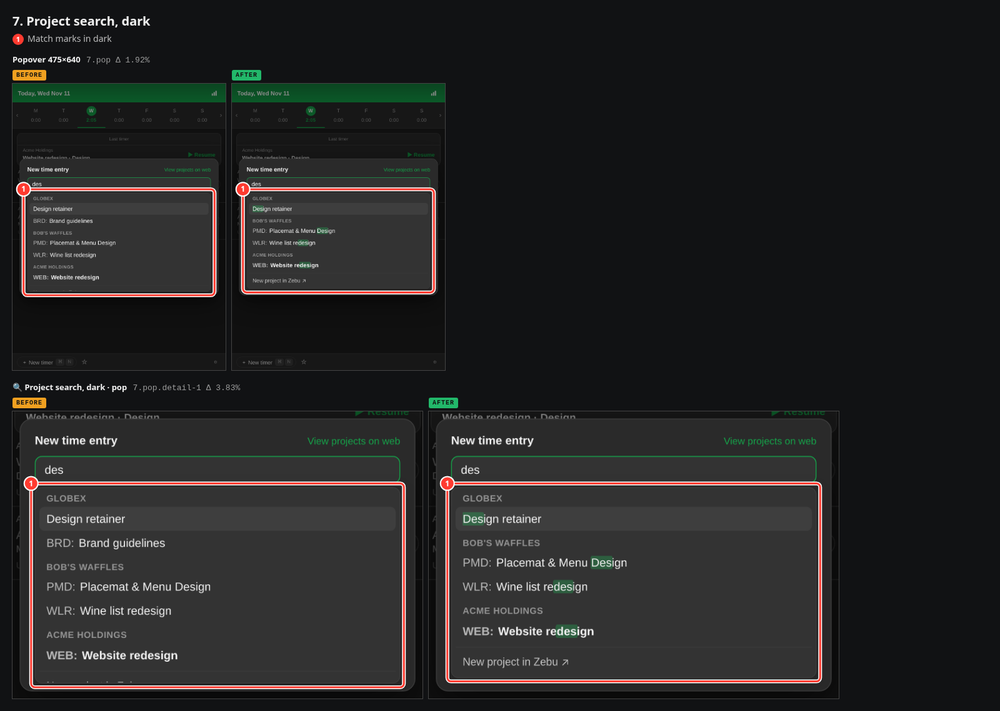

| Ref | View | Before | After | Diff | Δ px |
|---|---|---|---|---|---|
| `7.pop` | Popover 475×640 | [before](captures/before/search-dark/popover.png) | [after](captures/after/search-dark/popover.png) | [diff](diffs/search-dark_popover.png) | 1.92% |
| `7.pop.detail-1` | 🔍 Project search, dark · pop | [before](captures/before/search-dark/detail-1@popover.png) | [after](captures/after/search-dark/detail-1@popover.png) | [diff](diffs/search-dark_detail-1@popover.png) | 3.83% |

### 8. Settings › Keyboard shortcuts

Rendered in Chromium on Linux, which draws ⌃ as ^; the Mac shows the usual ⌃⌥⌘ glyphs.

**(1)** Bound from the first launch

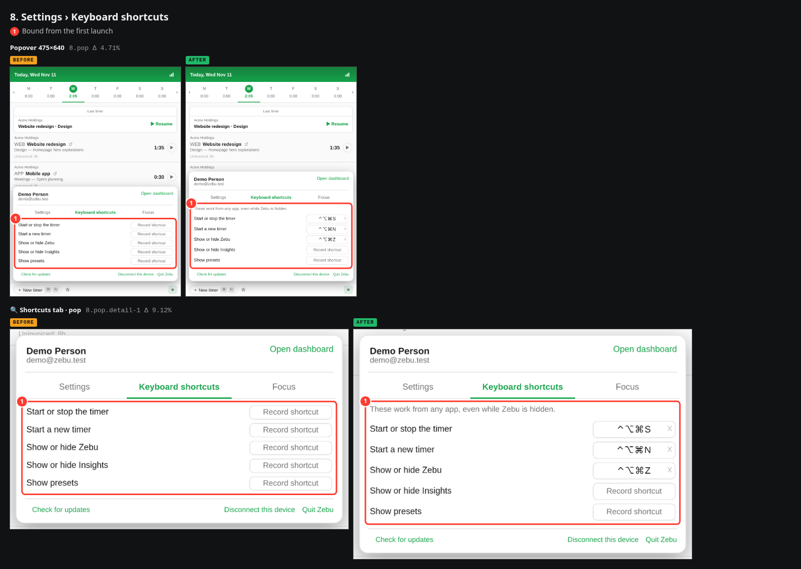

| Ref | View | Before | After | Diff | Δ px |
|---|---|---|---|---|---|
| `8.pop` | Popover 475×640 | [before](captures/before/shortcuts/popover.png) | [after](captures/after/shortcuts/popover.png) | [diff](diffs/shortcuts_popover.png) | 4.71% |
| `8.pop.detail-1` | 🔍 Shortcuts tab · pop | [before](captures/before/shortcuts/detail-1@popover.png) | [after](captures/after/shortcuts/detail-1@popover.png) | [diff](diffs/shortcuts_detail-1@popover.png) | 9.12% |

### 9. Keyboard shortcuts, dark

**(1)** Bound from the first launch

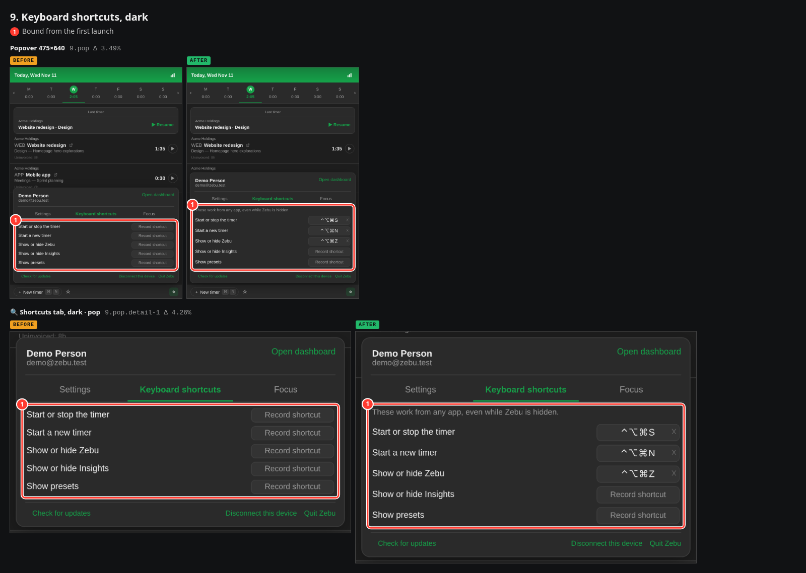

| Ref | View | Before | After | Diff | Δ px |
|---|---|---|---|---|---|
| `9.pop` | Popover 475×640 | [before](captures/before/shortcuts-dark/popover.png) | [after](captures/after/shortcuts-dark/popover.png) | [diff](diffs/shortcuts-dark_popover.png) | 3.49% |
| `9.pop.detail-1` | 🔍 Shortcuts tab, dark · pop | [before](captures/before/shortcuts-dark/detail-1@popover.png) | [after](captures/after/shortcuts-dark/detail-1@popover.png) | [diff](diffs/shortcuts-dark_detail-1@popover.png) | 4.26% |

### 10. Presets: type, then Return starts the top match

Before, Return in the search did nothing; a preset could only be started by clicking or tabbing to its row.

**(1)** Top match highlighted, matches marked

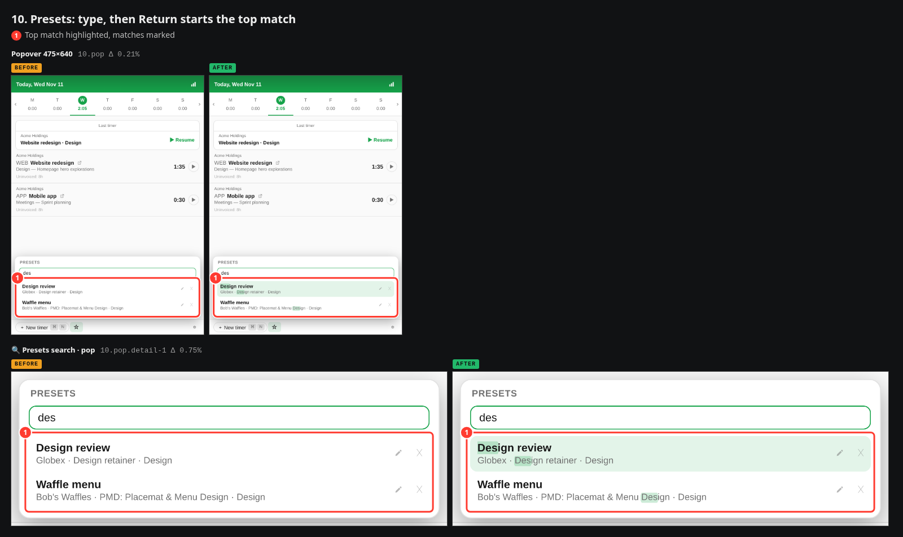

| Ref | View | Before | After | Diff | Δ px |
|---|---|---|---|---|---|
| `10.pop` | Popover 475×640 | [before](captures/before/presets-search/popover.png) | [after](captures/after/presets-search/popover.png) | [diff](diffs/presets-search_popover.png) | 0.21% |
| `10.pop.detail-1` | 🔍 Presets search · pop | [before](captures/before/presets-search/detail-1@popover.png) | [after](captures/after/presets-search/detail-1@popover.png) | [diff](diffs/presets-search_detail-1@popover.png) | 0.75% |

### 11. The day (regression check)

**(1)** Footer

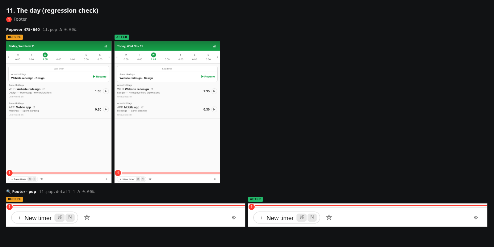

| Ref | View | Before | After | Diff | Δ px |
|---|---|---|---|---|---|
| `11.pop` | Popover 475×640 | [before](captures/before/main/popover.png) | [after](captures/after/main/popover.png) | [diff](diffs/main_popover.png) | 0.00% |
| `11.pop.detail-1` | 🔍 Footer · pop | [before](captures/before/main/detail-1@popover.png) | [after](captures/after/main/detail-1@popover.png) | [diff](diffs/main_detail-1@popover.png) | 0.00% |

## 6. Metadata

| | |
|---|---|
| Generated | Nov 11, 2026, 01:06 GMT+1 (2026-11-11T00:06:35.670Z) |
| Before | Nov 11, 2026, 01:03 GMT+1 · ad96bd4cb + 28 uncommitted file(s) on picker-tab-shortcuts — “Release 0.2.4” · http://127.0.0.1:5198 |
| After | Nov 11, 2026, 01:05 GMT+1 · ad96bd4cb + 28 uncommitted file(s) on picker-tab-shortcuts — “Release 0.2.4” · http://127.0.0.1:5199 |
| Commits since before | 1c67604 Tab picks in the search pickers, a sharper matcher, hotkeys bound on a Mac (#569) |
| Diff vs before | 28 files changed, 788 insertions(+), 91 deletions(-) · M	CLAUDE.md · M	README.md · M	src/App.vue · A	src/Hits.vue · M	src/ProjectPicker.vue · M	src/SearchSelect.vue · M	src/fuzzy.ts · M	src/locales/de.json · M	src/locales/en.json · M	src/locales/es.json · M	src/locales/fr.json · M	src/locales/it.json · M	src/locales/ja.json · M	src/locales/ko.json · M	src/locales/nl.json · M	src/locales/pl.json · M	src/locales/pt.json · M	src/locales/zh-CN.json · M	src/picker.ts · M	src/presets.ts · M	src/shortcuts.ts · M	src/style.css · M	src/tray.ts · M	tests/fuzzy.test.ts · M	tests/picker.test.ts · M	tests/presets.test.ts · M	tests/shortcuts.test.ts · M	tests/tray.test.ts |
| Viewports | popover 475×640@2x |
| Browser | Chromium 156.0.8078.4 |
| Agent | Claude Fable 5 |
| Report | .ui-reports/2026-11-11-0045-tab-picks-in-the-pickers-sharper-fuzzy-search-shortcuts-read |
