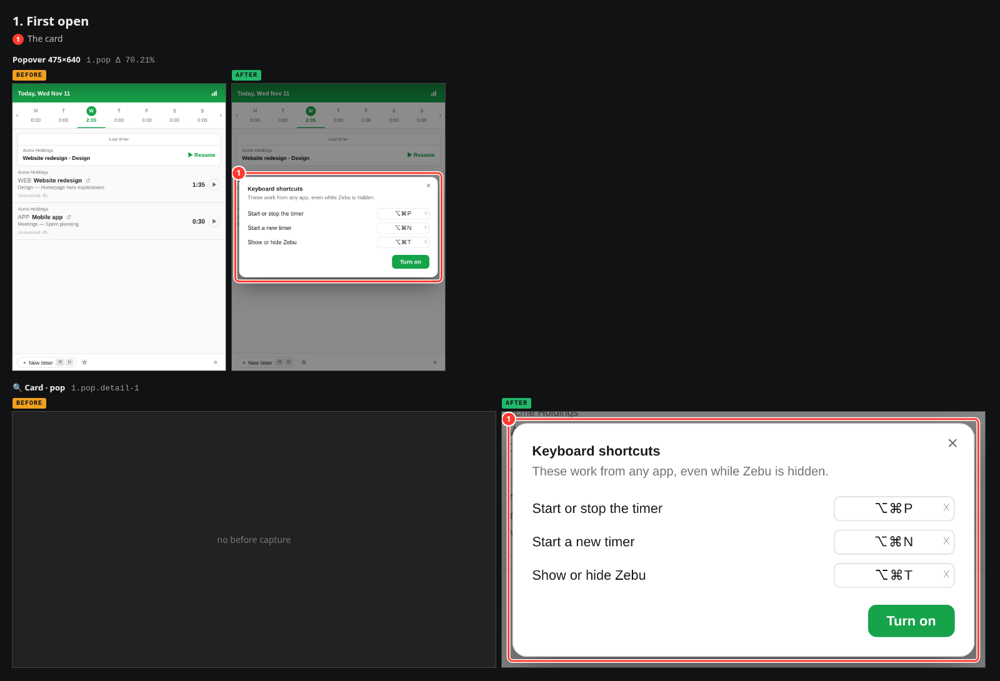
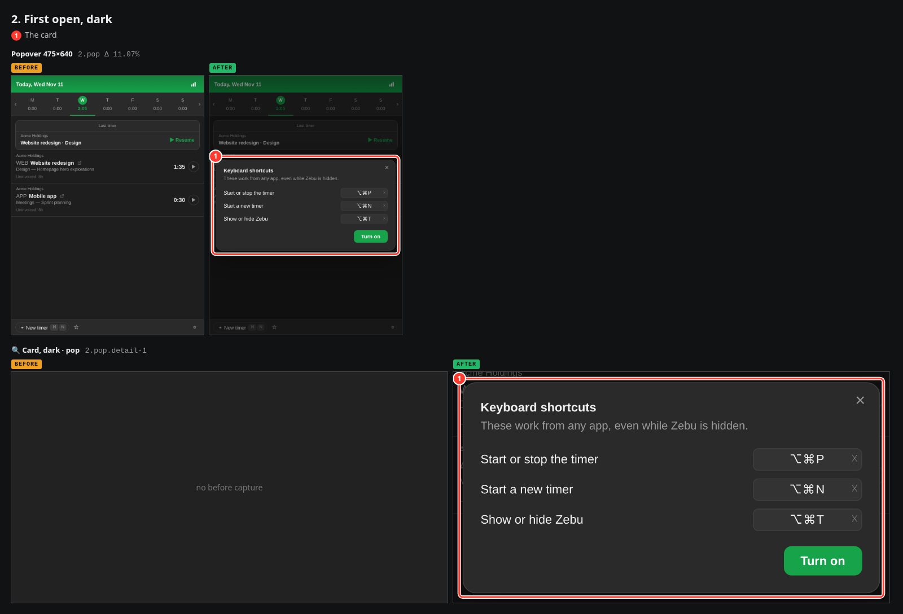
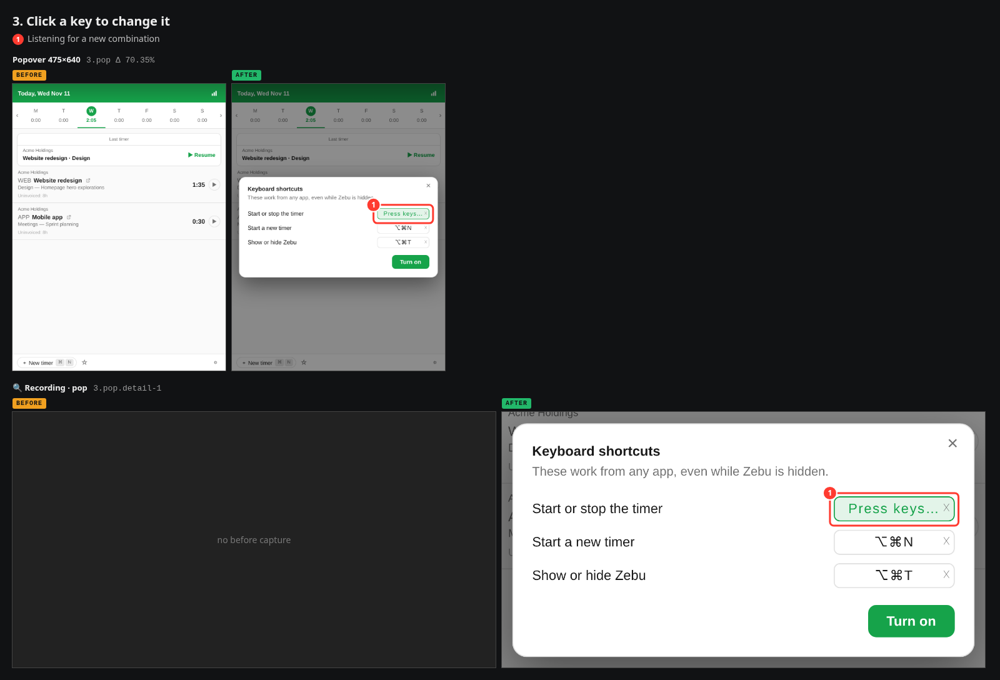
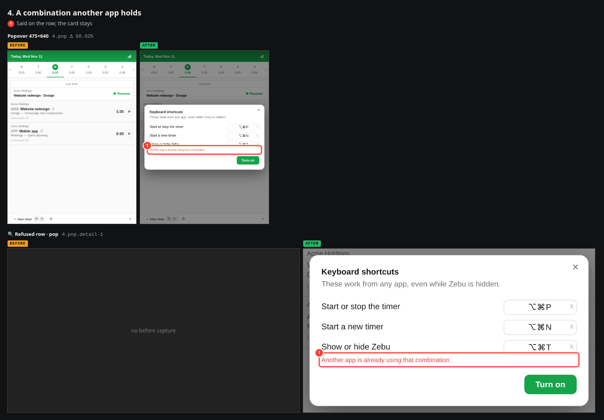
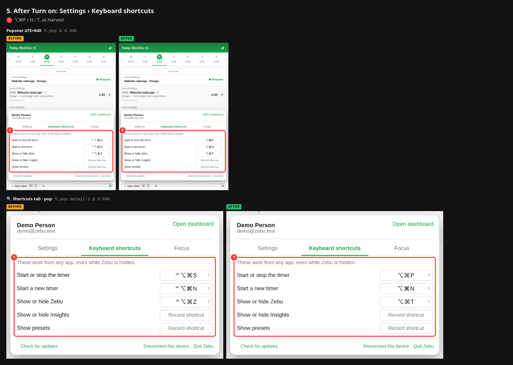
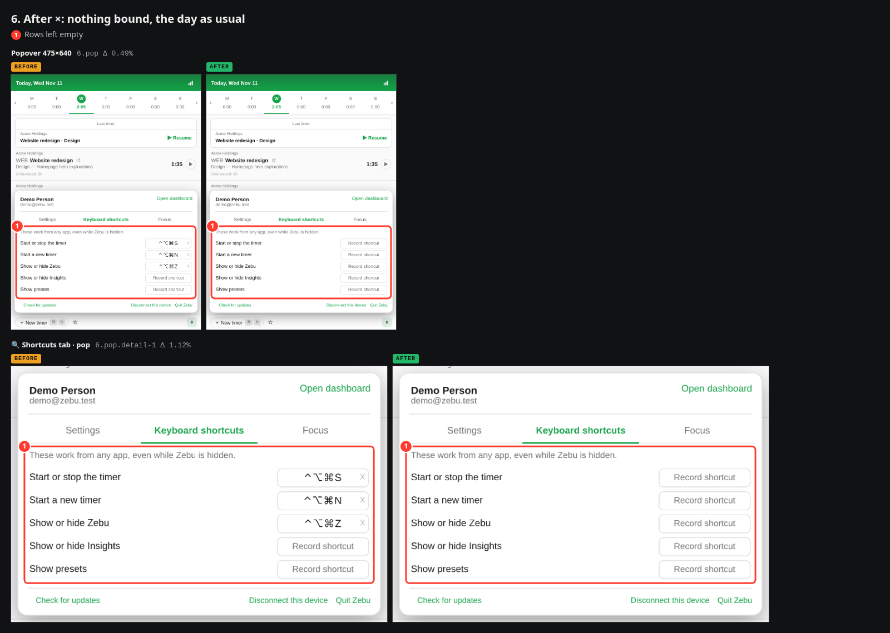

# UI change report — Shortcuts card on first open

*Nov 11, 2026, 01:28 GMT+1 · 88533312a → 88533312a (+uncommitted) · [interactive viewer](index.html)*

## 1. Original request

> Please look at the harvest default key bindings and perhaps have an onboarding to help new users set or learn the shortcuts. Please show me the flow and avoid extraneous text as much as possible it should be extremely clean, precise and simple

## 2. Interpretation

The three timer hotkeys were bound silently on a Mac, with keys of my own choosing. They now follow Harvest (⌥⌘N new timer, ⌥⌘T show/hide; Harvest has no start/stop key, so that one is ⌥⌘P) and are offered once on a single card the first time the popover opens: three rows, each one click to change, one button to turn them on.

## 3. Changes

1. Keys follow Harvest for Mac: ⌥⌘N new timer, ⌥⌘T show/hide; start/stop, which Harvest has no key for, is ⌥⌘P (was ⌃⌥⌘S / N / Z)
2. Nothing is bound silently any more: one card on first open offers the three, with one button, Turn on
3. Each key on the card is the recorder: click to change, ✕ to leave that row out
4. × or Escape binds nothing; Return is Turn on; the card never comes back
5. A combination another app holds is said on its row and the card stays
6. Rows already bound are shown as they are and left alone; no card when all three are bound, or off a Mac

## 4–5. Before / after

### 1. First open

Before, the hotkeys were bound without a word. After, one card.

**(1)** The card

| Ref | View | Before | After | Diff | Δ px |
|---|---|---|---|---|---|
| `1.pop` | Popover 475×640 | [before](captures/before/first-open/popover.png) | [after](captures/after/first-open/popover.png) | [diff](diffs/first-open_popover.png) | 70.21% |
| `1.pop.detail-1` | 🔍 Card · pop | — | [after](captures/after/first-open/detail-1@popover.png) | — | — |

### 2. First open, dark

**(1)** The card

| Ref | View | Before | After | Diff | Δ px |
|---|---|---|---|---|---|
| `2.pop` | Popover 475×640 | [before](captures/before/first-open-dark/popover.png) | [after](captures/after/first-open-dark/popover.png) | [diff](diffs/first-open-dark_popover.png) | 11.07% |
| `2.pop.detail-1` | 🔍 Card, dark · pop | — | [after](captures/after/first-open-dark/detail-1@popover.png) | — | — |

### 3. Click a key to change it

**(1)** Listening for a new combination

| Ref | View | Before | After | Diff | Δ px |
|---|---|---|---|---|---|
| `3.pop` | Popover 475×640 | [before](captures/before/change/popover.png) | [after](captures/after/change/popover.png) | [diff](diffs/change_popover.png) | 70.35% |
| `3.pop.detail-1` | 🔍 Recording · pop | — | [after](captures/after/change/detail-1@popover.png) | — | — |

### 4. A combination another app holds

**(1)** Said on the row; the card stays

| Ref | View | Before | After | Diff | Δ px |
|---|---|---|---|---|---|
| `4.pop` | Popover 475×640 | [before](captures/before/taken/popover.png) | [after](captures/after/taken/popover.png) | [diff](diffs/taken_popover.png) | 68.02% |
| `4.pop.detail-1` | 🔍 Refused row · pop | — | [after](captures/after/taken/detail-1@popover.png) | — | — |

### 5. After Turn on: Settings › Keyboard shortcuts

**(1)** ⌥⌘P / N / T, as Harvest

| Ref | View | Before | After | Diff | Δ px |
|---|---|---|---|---|---|
| `5.pop` | Popover 475×640 | [before](captures/before/turned-on/popover.png) | [after](captures/after/turned-on/popover.png) | [diff](diffs/turned-on_popover.png) | 0.34% |
| `5.pop.detail-1` | 🔍 Shortcuts tab · pop | [before](captures/before/turned-on/detail-1@popover.png) | [after](captures/after/turned-on/detail-1@popover.png) | [diff](diffs/turned-on_detail-1@popover.png) | 0.84% |

### 6. After ×: nothing bound, the day as usual

**(1)** Rows left empty

| Ref | View | Before | After | Diff | Δ px |
|---|---|---|---|---|---|
| `6.pop` | Popover 475×640 | [before](captures/before/dismissed/popover.png) | [after](captures/after/dismissed/popover.png) | [diff](diffs/dismissed_popover.png) | 0.49% |
| `6.pop.detail-1` | 🔍 Shortcuts tab · pop | [before](captures/before/dismissed/detail-1@popover.png) | [after](captures/after/dismissed/detail-1@popover.png) | [diff](diffs/dismissed_detail-1@popover.png) | 1.12% |

## 6. Metadata

| | |
|---|---|
| Generated | Nov 11, 2026, 01:28 GMT+1 (2026-11-11T00:28:22.222Z) |
| Before | Nov 11, 2026, 01:25 GMT+1 · 88533312a + 17 uncommitted file(s) on picker-tab-shortcuts — “docs(ui-report): keep the keyboard check script beside the report (#569)” · http://127.0.0.1:5198 |
| After | Nov 11, 2026, 01:27 GMT+1 · 88533312a + 17 uncommitted file(s) on picker-tab-shortcuts — “docs(ui-report): keep the keyboard check script beside the report (#569)” · http://127.0.0.1:5199 |
| Commits since before | 7e0e73a Hotkeys are offered on a first-run card, on Harvest's keys (#569) |
| Diff vs before | 16 files changed, 244 insertions(+), 61 deletions(-) · M	CLAUDE.md · M	README.md · M	src/App.vue · M	src/locales/de.json · M	src/locales/en.json · M	src/locales/es.json · M	src/locales/fr.json · M	src/locales/it.json · M	src/locales/ja.json · M	src/locales/ko.json · M	src/locales/nl.json · M	src/locales/pl.json · M	src/locales/pt.json · M	src/locales/zh-CN.json · M	src/shortcuts.ts · M	tests/shortcuts.test.ts |
| Viewports | popover 475×640@2x |
| Browser | Chromium 156.0.8078.4 |
| Agent | Claude Fable 5 |
| Report | .ui-reports/2026-11-11-0118-shortcuts-card-on-first-open |
